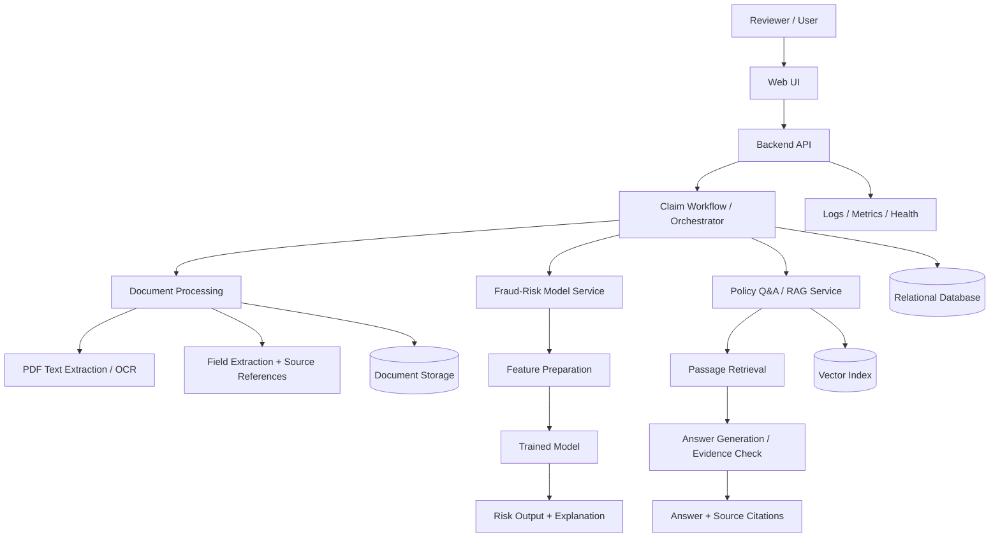

# Insurance Claims Intelligence Platform
## End-to-End Project Plan and Implementation Blueprint

**Document type:** Project plan / technical project blueprint  
**Project status:** Pre-development — no implementation has been verified  
**Team size:** 3 members  
**Planning horizon:** 8–10 weeks for a portfolio-quality MVP, depending on dataset access and team availability  
**Primary audience:** Student development team, project supervisor, future maintainers and reviewers  
**Version:** 1.0  
**Last updated:** 14 October 2026

---

## Document Control

| Field | Details |
|---|---|
| Project name | Insurance Claims Intelligence Platform |
| Project category | Applied machine learning, document intelligence, retrieval-augmented generation (RAG), full-stack application |
| Intended users | Insurance claim reviewers / adjusters in a demonstration scenario |
| Delivery type | Working MVP with reproducible evaluation, documentation and demo |
| Deployment ownership | Application team prepares application requirements; production deployment may be handled by DevOps |
| Status of statements in this plan | Proposed design and targets must be confirmed during the discovery phase |

> **Important:** This is a plan, not a description of an existing system. The repository, APIs, database, tests, integrations and deployment have not yet been implemented or verified. All proposed choices should be reviewed against actual dataset availability, licences, compute limits and team capacity.

---

# 1. Executive Summary

The Insurance Claims Intelligence Platform is a decision-support application intended to help a claim reviewer examine claim documents, understand a machine-learning fraud-risk estimate, and search policy wording through question answering with citations.

The MVP combines three technical capabilities in one workflow:

1. **Document intelligence:** accept selected claim documents, extract text and a limited set of fields, and identify missing or uncertain information.
2. **Fraud-risk estimation:** use a suitable labelled dataset to estimate whether a case resembles patterns associated with previously labelled suspicious/fraudulent cases, and explain the model output.
3. **Policy-document Q&A:** retrieve relevant passages from a curated set of policy documents and answer questions with citations to those passages.

A lightweight application will connect these capabilities, store claim metadata and processing results, and expose basic tests, logs and health checks.

The system is a **human decision-support tool**, not an automated adjudication system. A model score is not proof of fraud, and generated answers are not authoritative legal or coverage decisions. A reviewer remains responsible for decisions.

The most important feasibility risk is the availability of a relevant, legally usable, labelled **insurance-claim fraud dataset**. This must be checked before committing to the fraud-model scope. Transaction-fraud data, receipt datasets and synthetic examples may be useful for specific technical experiments, but they do not establish that a model works for insurance claims.

## 1.1 Project goal

Build a reproducible, demonstrable end-to-end application that connects document processing, fraud-risk modelling and evidence-grounded policy Q&A in one reviewer workflow.

## 1.2 Proposed success criteria

The team should agree on final targets after inspecting the data. Initial acceptance criteria are:

- A user can create a demo claim and attach supported sample documents.
- The document pipeline extracts the agreed fields and preserves source information for review.
- The fraud module trains and evaluates a baseline on a clearly documented, appropriate dataset, if one is available.
- The application displays a risk estimate and a clear explanation of what it does and does not mean.
- The Q&A module returns relevant source passages and citations, and handles unsupported questions without inventing policy terms.
- The complete demo workflow runs from claim creation through viewing results.
- Automated tests cover the main workflow and important failure cases.
- Setup instructions, data sources/licences, evaluation results, known limitations and handover requirements are documented.

These are **acceptance criteria**, not claims that the project already meets them.

---

# 2. Background and Problem Statement

## 2.1 Problem

Claim review can involve several documents, including claim forms, invoices, reports and policy documents. Relevant information may be scattered across files, repeated inconsistently or stored in scanned PDFs. Reviewers may spend time extracting facts, checking policy language and deciding which cases need further investigation.

A software tool can help organize these tasks. However, OCR can misread documents, fraud models can generate false positives and false negatives, and language models can produce unsupported answers. The project must therefore prioritize traceability, evaluation and human review rather than simply combining AI components.

## 2.2 Proposed solution

Create one application where a reviewer can:

1. Open or create a claim.
2. Upload supporting documents.
3. Review extracted fields and missing or uncertain information.
4. View a model-generated fraud-risk estimate with an explanation.
5. Ask questions about selected policy or claim documents.
6. Inspect the cited source passages.
7. Review processing status and errors.

## 2.3 Primary use case

**Use case:** A reviewer receives a demonstration claim with supporting documents and wants to understand its contents, check relevant policy wording and decide whether further investigation may be appropriate.

**Preconditions:**
- The reviewer has access to the application.
- The files are in supported formats.
- The policy documents are permitted for use.
- The fraud model has been trained and evaluated on an appropriate dataset, or the fraud module is explicitly marked as a prototype if such data is unavailable.

**Expected outcome:** The reviewer sees extracted information, an appropriately qualified risk estimate if supported, and answers linked to source passages.

## 2.4 Out of scope for the first version

- Automatically approving, rejecting or denying claims.
- Declaring that a claimant committed fraud.
- Production integration with a real insurer's claims-management system.
- Supporting every insurance line, document layout or language.
- Guaranteed extraction from every scan.
- Fully autonomous investigation or claim settlement.
- Large-scale enterprise multi-tenancy and complex role management.
- Training a large language model from scratch.
- Claims of real-world fraud detection performance without representative, labelled evaluation data.

---

# 3. Stakeholders and Intended Users

| Stakeholder | Interest / responsibility |
|---|---|
| Project team (3 developers) | Scope, design, implementation, testing, evaluation and documentation |
| Project supervisor / reviewer | Review project quality, research approach and deliverables |
| Demonstration user (claim reviewer) | Inspect claim details, risk output and policy evidence |
| Future maintainer | Understand setup, interfaces, dependencies, known issues and pending work |
| DevOps / deployment owner, if applicable | Deploy the application using documented runtime and dependency requirements |

No real insurer or business stakeholder is assumed to have approved the system. If a real domain expert becomes available, use their feedback to validate workflows and terminology.

---

# 4. Requirements

## 4.1 Functional requirements

| ID | Requirement | Priority | Acceptance evidence |
|---|---|---:|---|
| FR-01 | Create and view a claim record | Must | Claim has a stable ID and visible status |
| FR-02 | Upload supported documents to a claim | Must | Valid file accepted; invalid file rejected safely |
| FR-03 | Extract text from digital PDFs and support OCR for selected scanned files | Must | Output can be compared with verified sample text |
| FR-04 | Extract an agreed, limited set of fields | Must | Fields, confidence/uncertainty and source references are displayed where possible |
| FR-05 | Flag missing or uncertain extracted values | Must | Reviewer can identify fields requiring manual review |
| FR-06 | Train and evaluate a baseline fraud-risk model on suitable labelled data | Must, subject to data feasibility | Reproducible evaluation report with dataset limitations |
| FR-07 | Display risk output and a human-readable explanation | Must | Score is clearly labelled as a model estimate, not a verdict |
| FR-08 | Index permitted policy documents for retrieval | Must | Relevant passages can be retrieved for known test questions |
| FR-09 | Answer questions using retrieved passages and show citations | Must | Citation points to an actual source document/passage |
| FR-10 | Handle unsupported questions without fabricating policy facts | Must | Negative tests show an uncertainty/insufficient-evidence response |
| FR-11 | Connect modules in one claim workflow | Must | End-to-end integration test passes |
| FR-12 | Record processing status and useful errors | Must | User can distinguish success, failure and in-progress states |
| FR-13 | Provide basic health/readiness checks | Should | Checks do not expose secrets |
| FR-14 | Provide automated tests and setup documentation | Must | Tests run from documented commands |
| FR-15 | Add authentication and role controls | Should for local demo; Must before real sensitive data or public exposure | Access rules tested and documented |

## 4.2 Non-functional requirements

| ID | Requirement | Practical interpretation |
|---|---|---|
| NFR-01 | Reproducibility | Record data version, random seeds where relevant, model version and evaluation procedure |
| NFR-02 | Explainability | Present important model factors carefully and avoid causal claims |
| NFR-03 | Traceability | Keep source references for extracted fields and RAG citations |
| NFR-04 | Reliability | Handle invalid files, missing data, unavailable models and dependency failures |
| NFR-05 | Security | Validate uploads, protect secrets, restrict access and avoid unnecessary sensitive logging |
| NFR-06 | Maintainability | Use modular components, readable interfaces, tests and documented setup |
| NFR-07 | Resource awareness | Prefer models and tools that can be run within the team's actual compute budget |
| NFR-08 | Honest evaluation | Report class balance, data splits, metrics and limitations; do not report invented targets as results |
| NFR-09 | Usability | Make statuses, citations, uncertainty and risk meaning clear to a non-technical reviewer |

---

# 5. Scope and MVP Definition

## 5.1 MVP features

The first deliverable should be a small but complete workflow rather than three disconnected notebooks.

### A. Claim and document workflow
- Create a claim record.
- Upload a small set of supported files.
- Store file references and processing status.
- Extract text and a limited field set.
- Display extracted results and uncertainty.

### B. Fraud-risk model
- Inspect the dataset and target definition.
- Build a simple baseline.
- Evaluate using appropriate metrics and a held-out test set.
- Display a risk score and explanation.
- Clearly disclose when the dataset is not insurance-claim-specific.

### C. Policy Q&A
- Use a small curated set of permitted policy PDFs.
- Retrieve passages relevant to a question.
- Generate an answer grounded in the retrieved evidence.
- Display document/page or passage citations.
- Abstain when evidence is insufficient.

### D. Application and engineering
- One simple user interface.
- Backend API that connects the modules.
- Database for claim metadata and results.
- Basic validation, automated tests, logs and health check.
- README, architecture diagram, evaluation report and demo.

## 5.2 Features to defer

- Advanced multi-agent workflows.
- Fine-tuning a language model.
- Complex fraud graph analytics.
- Large-scale distributed processing.
- Multiple insurer integrations.
- Advanced user administration and dashboards.
- Production-grade monitoring stacks before the MVP works.

---

# 6. Data Strategy and Feasibility Gate

This is the project's most important early decision. Do not build the fraud module around an assumed dataset.

## 6.1 Data categories needed

| Data category | Purpose | Minimum investigation |
|---|---|---|
| Labelled fraud-risk data | Train and evaluate the fraud model | Confirm domain, labels, licence, feature meanings, class balance and permitted use |
| Claim-like documents | Test OCR and field extraction | Confirm formats, layouts, source and permission |
| Policy documents | Build and test document Q&A | Use permitted public or authored documents and retain source/page metadata |
| Evaluation questions and expected answers | Measure RAG correctness and citation quality | Manually verify answers against the source documents |
| Synthetic demo records | Demonstrate workflow and edge cases | Label clearly as synthetic; never treat them as evidence of real-world performance |

## 6.2 Candidate document datasets to investigate

These are candidates for document-processing experiments, not confirmed insurance datasets:

- **CORD:** receipt understanding.
- **SROIE:** receipt text and information extraction.
- **FUNSD:** form understanding.
- **XFUND:** multilingual form understanding.

They may help test OCR or extraction methods but do not by themselves validate insurance claim processing. Verify each dataset's current access conditions and licence before use.

## 6.3 Fraud dataset decision

Before selecting a model, document:

- What each row represents.
- The precise meaning of the target label.
- Whether the data concerns insurance claims, transactions or another fraud domain.
- The feature definitions and whether they are available at the time of prediction.
- Missing values, duplicates, class distribution and potential leakage.
- Licence, allowed use and any privacy restrictions.
- Whether train/test separation can be done without related records leaking across splits.

**Important distinction:** IEEE-CIS Fraud Detection is a transaction-fraud dataset, not an insurance-claim fraud dataset. It can support a separate transaction-fraud experiment, but results from it must not be presented as insurance-claim fraud performance.

### Go/no-go rule

- **Go:** A suitable labelled dataset is found and its use is permitted. Proceed with the insurance fraud-risk model.
- **Conditional go:** No suitable dataset is found, but the team still wants to demonstrate model integration. Either use a clearly labelled, domain-limited benchmark as a separate experiment or demonstrate the interface with synthetic scores. Do not claim validated insurance-fraud prediction.
- **No-go on the claim:** Do not advertise the fraud component as a validated insurance fraud detector if its data does not support that conclusion.

## 6.4 Data governance

- Do not upload real personal or insurance records without explicit permission and an appropriate privacy/security plan.
- Do not commit private/raw data, credentials or personally identifiable information to Git.
- Keep dataset licences and source links in `docs/datasets.md`.
- Maintain a small manually checked evaluation set separate from model training.
- Document data cleaning and transformations so results can be reproduced.

---

# 7. Proposed System Architecture

## 7.1 Logical architecture diagram



This is a logical design. The final topology and exact technologies depend on the feasibility phase. Do not interpret it as a deployed architecture.

## 7.2 Component responsibilities

| Component | Responsibility | Input | Output |
|---|---|---|---|
| Frontend | Claim list/detail, upload, results and Q&A | User actions and API responses | Requests to backend |
| Backend API | Validate requests, coordinate workflow and return results | API requests | Structured responses and status |
| Document processing | Extract text and selected fields | Uploaded document | Text, fields, confidence and source references |
| Fraud service | Prepare features and run model inference | Approved structured features | Risk estimate, model version and explanation |
| RAG service | Retrieve passages and formulate evidence-grounded answers | Question and document corpus | Answer, citations and confidence/abstention state |
| Database | Persist structured claim data and results | Application records | Stored/retrievable records |
| File storage | Store original files and derived artifacts if needed | File content | Stable file references |
| Vector index | Retrieve semantically relevant passages | Chunk embeddings and query embedding | Ranked passages and metadata |
| Observability | Record errors, timings and service state | Application events | Logs, metrics and health responses |

## 7.3 Main data flow

1. A reviewer creates a claim and uploads supported documents.
2. The backend validates the file and associates it with a stable claim ID.
3. The document module extracts text and selected fields, preserving provenance.
4. The reviewer can correct uncertain fields where the UI supports correction.
5. The fraud service receives only approved, available-at-prediction-time features.
6. The RAG service retrieves policy passages and produces an answer with citations.
7. The UI displays outputs and status; errors are captured in logs.
8. Each result should be linked to the model/index version that produced it where practical.

## 7.4 Architecture principles

- Use a stable `claim_id` across the modules.
- Keep UI, business logic, data access and model code separate.
- Start with synchronous processing for small files if it is sufficient; add workers/queues only if measurements show they are needed.
- Keep original files and derived text/results traceable.
- Do not pass unnecessary sensitive content to external APIs.
- Treat all uploaded documents as untrusted input.

---

# 8. Recommended Technology Stack

These are starting recommendations, not mandatory choices. Confirm them after a small proof of concept.

| Layer | Recommended starting choice | Reason / note |
|---|---|---|
| Language | Python | Shared ecosystem for data, ML and API |
| Data handling | Pandas, NumPy | Dataset inspection and transformations |
| Baseline ML | scikit-learn | Strong baseline and reproducible evaluation |
| Optional boosting | XGBoost or LightGBM | Consider after baseline and dataset checks |
| Model explanation | SHAP or simpler feature importance | Use only when appropriate for the selected model |
| PDF extraction | A maintained PDF text extraction library | Digital PDFs may not need OCR |
| OCR | Tesseract or PaddleOCR | Compare on a small set of representative files |
| Embeddings | Sentence Transformers or another selected embedding model | Choose based on retrieval quality and resource use |
| Vector retrieval | FAISS for a simple local index; Chroma is an alternative | Avoid unnecessary infrastructure for an MVP |
| Generation | Small compatible open model or optional hosted API | Decide based on quality, privacy, cost and compute |
| Backend | FastAPI | Typed request/response models and OpenAPI support |
| Frontend | Streamlit for the first MVP | Fast to build a demonstration workflow |
| Database | PostgreSQL | Structured records and relationships |
| Database migrations | Alembic, if SQLAlchemy is used | Versioned schema changes |
| Testing | pytest | Unit and integration tests |
| Version control | Git and GitHub | Branching, reviews and collaboration |
| Packaging | Docker when useful | Reproducible service environment |
| CI | GitHub Actions or equivalent | Automated tests on pull requests |
| Monitoring | Structured logs and basic metrics first | Add a dedicated tool only if needed |

**Avoid tool sprawl:** do not use multiple orchestration frameworks, databases, vector stores or model providers just to make the project look more advanced. A small, well-evaluated system is stronger than a broad, unreliable one.

---

# 9. Module Design

## 9.1 Module A — Claim and Document Management

**Purpose:** Create the record that connects the uploaded files, extracted fields, model assessment and Q&A activity.

**Planned responsibilities**
- Create and retrieve claims.
- Validate file type and size.
- Store metadata and stable file references.
- Track processing state.
- Return clear errors for unsupported or corrupt files.

**Key business rules**
- Each claim has a stable unique identifier.
- Each document is linked to a claim.
- A file upload does not imply successful extraction.
- File names must not be trusted as unique identifiers.
- Store only necessary metadata and protect uploaded files.

**Acceptance tests**
- Valid file is accepted.
- Unsupported/oversized file is rejected safely.
- A document cannot silently become associated with the wrong claim.
- Processing failure is visible and does not corrupt the claim record.

## 9.2 Module B — Document Processing and Field Extraction

**Purpose:** Turn supported documents into searchable text and a limited set of structured fields.

**Initial field examples**
- Document type.
- Claim reference, if present.
- Date.
- Amount.
- Named parties only if needed and appropriate for the dataset.
- Source document and page/location.
- Confidence or review-required status.

The team must finalize fields after examining sample documents. Do not promise extraction of fields that are not consistently available.

**High-level workflow**
1. Detect whether the PDF contains selectable text.
2. Extract text directly when possible.
3. Apply OCR to scanned pages when necessary.
4. Normalize text conservatively.
5. Extract the selected fields.
6. Preserve source references and uncertainty.
7. Return results for human review.

**Quality measurement**
- Field-level exact match.
- Precision/recall for field detection where applicable.
- OCR character/word error rate if a verified transcription exists.
- Processing time and failure rate.

**Acceptance tests**
- Digital PDF.
- Scanned document.
- Missing expected field.
- Low-quality scan.
- Unsupported file type.
- Extraction result links back to the correct source.

## 9.3 Module C — Fraud-Risk Model

**Purpose:** Estimate whether a claim resembles patterns in the selected labelled dataset that are associated with the dataset's positive class.

**High-level workflow**
1. Confirm target meaning and dataset licence.
2. Explore data, class balance, missing values and duplicates.
3. Define a leakage-safe split strategy.
4. Build a simple baseline.
5. Compare a limited number of candidate models.
6. Tune thresholds using validation data, not the final test set.
7. Evaluate once on the held-out test set.
8. Save the preprocessing pipeline and model together.
9. Expose an inference function and explanation.
10. Record model version and evaluation details.

**Metrics**
- Precision and recall.
- F1 score.
- PR-AUC for an imbalanced positive class.
- Confusion matrix at the selected threshold.
- ROC-AUC as a secondary metric where appropriate.
- Calibration checks if the score is presented as a probability.
- Inference time.

Accuracy alone is insufficient for highly imbalanced data. The cost of missed cases and unnecessary reviews should influence threshold selection.

**Important rules**
- Never treat the score as proof of fraud.
- Do not use future outcomes or investigation results that would not be available at prediction time.
- Do not balance or resample before splitting data; any resampling belongs inside the training pipeline.
- Keep a test set untouched during model selection.
- Explain the actual dataset domain and limitations.

**Fallback if suitable data is unavailable**
Use a clearly labelled demonstration output or a separate domain-specific experiment. Keep the software integration, but do not describe it as a validated insurance fraud detector.

## 9.4 Module D — Policy Q&A / RAG

**Purpose:** Help a reviewer locate policy evidence and ask natural-language questions about permitted documents.

**High-level workflow**
1. Collect a small set of permitted policy PDFs.
2. Extract text while preserving document and page information.
3. Split text into passages/chunks.
4. Generate embeddings for passages.
5. Store embeddings and metadata in a local vector index.
6. Embed the user's question and retrieve relevant passages.
7. Generate an answer using only the retrieved evidence.
8. Return citations to document/page/passage.
9. Abstain or ask for clarification when evidence is insufficient.

**Evaluation set**
Create questions with verified expected answers and source passages. Include:
- Questions clearly answered by a policy.
- Questions requiring multiple passages.
- Questions with ambiguous wording.
- Questions not answered by the corpus.
- Questions designed to expose citation errors.
- Documents containing instructions that should be treated as untrusted text.

**Metrics**
- Retrieval Recall@k or another suitable retrieval metric.
- Answer correctness judged against verified evidence.
- Citation validity and citation support.
- Unsupported-answer/abstention behaviour.
- End-to-end response time.

**Key rule:** a plausible answer is not enough. The cited text must actually support the answer.

## 9.5 Module E — Frontend and Workflow Integration

**Purpose:** Present the modules as one coherent application.

**Suggested screens**
- Claim list / create claim.
- Claim detail and document upload.
- Extracted fields and processing status.
- Fraud-risk result and explanation.
- Policy Q&A with citations.
- Error/status feedback.

**MVP usability principles**
- Label risk scores clearly.
- Show uncertainty and missing information.
- Make citations inspectable.
- Do not hide failed processing.
- Do not represent model outputs as final claim decisions.

## 9.6 Module F — Quality, Logging and Health

**Purpose:** Make failures understandable and the system maintainable.

**Log**
- Request/correlation ID.
- Claim/document IDs where appropriate.
- Module and processing stage.
- Success/failure state.
- Duration and error category.
- Model/index version when relevant.

**Do not log**
- Passwords, API keys or tokens.
- Full sensitive document contents without a clear, approved need.
- Personal data unnecessarily.

**Health checks**
- `/health` can report whether the application process is running.
- A separate readiness check may verify required dependencies.
- Health endpoints must not expose credentials or internal sensitive configuration.

---

# 10. Proposed Data Model

This is a conceptual starting point. Final table names, constraints and relationships must be designed when the workflow is implemented.

## 10.1 Candidate entities

| Entity | Example fields | Purpose |
|---|---|---|
| `claims` | `claim_id`, claim type, status, created/updated timestamps | Core claim record |
| `documents` | `document_id`, `claim_id`, file reference, document type, status | Uploaded files and processing state |
| `extracted_fields` | `field_id`, `document_id`, field name, value, confidence, source reference | Extracted information and provenance |
| `fraud_assessments` | `assessment_id`, `claim_id`, score, model version, threshold, explanation summary, timestamp | Versioned risk results |
| `qa_events` | `qa_id`, `claim_id`, question, answer, citation references, model/index version, timestamp | Q&A traceability |
| `audit_events` | event ID, claim/document reference, event type, timestamp, safe metadata | Important workflow events |

## 10.2 Relationships

- One claim can have many documents.
- One document can have many extracted fields.
- One claim can have multiple fraud assessments over time.
- One claim can have multiple Q&A events.
- Audit events can reference the relevant claim or document.

## 10.3 Storage decisions

- Store structured records in the relational database.
- Store original files in a protected file location or object storage, depending on deployment.
- Store vector indexes separately if appropriate.
- Keep stable references between records and files.
- Avoid storing duplicate copies of large content without a reason.
- Define retention/deletion behaviour before using sensitive data.

## 10.4 Migration policy

If the team uses SQLAlchemy with PostgreSQL, Alembic is a reasonable migration candidate. Commit schema migrations with code and test them on a clean database. Never assume that editing a model file automatically updates an existing database.

---

# 11. Proposed API Contract

No endpoints exist yet. These are proposed endpoint groups to refine before implementation.

| Method and route | Purpose | Expected result |
|---|---|---|
| `POST /claims` | Create claim | Claim ID and initial status |
| `GET /claims` | List claims | Paginated claim summaries, if needed |
| `GET /claims/{claim_id}` | Retrieve claim | Claim metadata and processing state |
| `POST /claims/{claim_id}/documents` | Upload a document | Document ID and processing status |
| `GET /claims/{claim_id}/documents` | List claim documents | Document metadata and status |
| `GET /documents/{document_id}` | Retrieve document processing summary | Extracted fields and source references |
| `POST /claims/{claim_id}/fraud-assessment` | Request risk assessment | Score, model version and explanation |
| `POST /claims/{claim_id}/questions` | Ask a question about selected documents | Answer, citations and abstention/status information |
| `GET /health` | Liveness check | Basic process status |
| `GET /ready` | Optional readiness check | Dependency readiness without secret details |

## 11.1 API conventions

- Use validated request and response schemas.
- Return appropriate HTTP status codes and a consistent error structure.
- Validate file type, size and input length.
- Use pagination if list endpoints can grow.
- Do not expose internal stack traces to clients.
- Record correlation IDs for debugging.
- Decide authentication and authorization before public access or use of real sensitive data.
- Generate API documentation from the actual implementation, not from this proposal alone.

If FastAPI is selected, its OpenAPI/Swagger UI is commonly available at `/docs` and the schema at `/openapi.json`, unless configuration changes those paths.

---

# 12. Repository Structure and Engineering Conventions

The repository does not yet exist. A possible structure is:

```text
insurance-claims-intelligence/
├── frontend/
│   └── app.py
├── backend/
│   └── main.py
├── app/
│   ├── api/
│   ├── core/
│   ├── database/
│   ├── document_ai/
│   ├── fraud/
│   ├── rag/
│   └── services/
├── scripts/
│   ├── prepare_data.py
│   └── evaluate_models.py
├── tests/
│   ├── unit/
│   └── integration/
├── data/
│   └── README.md
├── models/
│   └── README.md
├── docs/
│   ├── project_plan.md
│   ├── architecture.md
│   ├── datasets.md
│   ├── evaluation.md
│   └── handover.md
├── .env.example
├── .gitignore
├── README.md
├── requirements.txt
└── Dockerfile
```

This is a suggested scaffold; adapt it if a simpler layout is easier for the team.

## 12.1 Repository rules

- Keep notebooks for exploration, not as the only implementation.
- Move reusable logic into importable modules.
- Keep generated datasets, private files, model artifacts and local environment files out of Git unless there is an explicit, safe reason to version them.
- Commit dependency versions or a lock file.
- Use descriptive names and small, focused modules.
- Add tests with each module, not only at the end.
- Never commit `.env`, credentials or access tokens.
- Keep README instructions executable and current.

---

# 13. Security, Privacy and Responsible Use

Although this is a portfolio project, document processing and fraud scoring can involve sensitive data and consequential decisions.

## 13.1 Minimum safeguards

- Use public, licensed or synthetic data for development unless there is explicit permission for real data.
- Validate uploaded file types and size; do not trust extensions alone.
- Keep secrets in environment configuration or a secret manager, never in source code.
- Restrict access to uploaded files and claim records.
- Avoid unnecessary sensitive information in logs.
- Treat text inside uploaded documents as untrusted content.
- Do not let instructions inside a document override the application's system rules.
- Make model limitations and the human-review requirement visible.
- Record which model version produced an assessment.
- Document retention and deletion behaviour if data persists beyond a demo session.

## 13.2 Threats to consider

| Threat | Example mitigation |
|---|---|
| Malicious upload | Type/size validation, safe parsing and controlled storage |
| Prompt injection in a PDF | Treat retrieved passages as data, not instructions; test adversarial documents |
| Unsupported generated answer | Require evidence, validate citations and abstain when uncertain |
| Data leakage | Restrict access, avoid unnecessary logging and use approved datasets |
| Model leakage | Exclude future/outcome fields and use leakage-safe data splits |
| Overreliance on score | Label the output as a risk estimate and require human review |
| Secret exposure | Environment-based configuration, `.gitignore` and secret scanning where available |

This project is not a substitute for a formal security, legal or regulatory review before any real-world deployment.

---

# 14. Testing and Evaluation Plan

## 14.1 Test layers

| Layer | What to test |
|---|---|
| Unit | Validation, field normalization, feature preparation, citation formatting and error handling |
| Data quality | Label consistency, duplicates, missing values, leakage and split integrity |
| ML evaluation | Baseline comparison, threshold selection, test-set metrics and reproducibility |
| Document evaluation | Field accuracy, OCR quality, unsupported files and extraction failures |
| RAG evaluation | Retrieval relevance, answer correctness, citation support and abstention |
| API integration | Valid requests, invalid requests, error responses and persistence |
| End-to-end | Create claim → upload → process → assess → ask question → inspect output |
| Operational | Startup, health/readiness, dependency failure, logging and configuration |

## 14.2 Fraud-model evaluation protocol

1. Write down what the target label means.
2. Inspect class balance and the data-generating process.
3. Separate training, validation and test data appropriately.
4. Prevent related records or duplicated entities from leaking across splits.
5. Fit preprocessing only on training data.
6. Establish a simple baseline before adding complex models.
7. Choose thresholds using validation data and explain the trade-off.
8. Report precision, recall, F1, PR-AUC and the confusion matrix; add other metrics when justified.
9. Report test-set size, positive-class count and important limitations.
10. Do not claim that the model is ready for operational decisions solely because a metric is high.

## 14.3 Document extraction evaluation

Prepare a small manually verified reference set. Compare extracted values to reference values and report performance per field. Include poor-quality scans and missing fields rather than evaluating only clean examples.

## 14.4 RAG evaluation

Prepare questions with source passages and verified answers before tuning the system. Measure retrieval and answer quality separately. Check whether citations support the answer, not merely whether a citation is present.

## 14.5 Release gate

Do not call the MVP complete until:
- The core end-to-end workflow works.
- Main unit and integration tests pass.
- Evaluation results are reproducible.
- Major known failures are documented.
- The README works in a clean environment.
- No credentials or unapproved sensitive data are in the repository.

---

# 15. Implementation Roadmap

A realistic plan for three people is **8–10 weeks**, assuming part-time student work. Dataset availability and integration failures may change this timeline.

| Phase | Indicative timing | Main activities | Deliverable / gate |
|---|---|---|---|
| 0. Discovery and feasibility | Week 1 | Confirm scope, inspect dataset options, licences, sample documents and compute limits | Scope agreed; fraud-data go/no-go decision |
| 1. Design and repository setup | Week 1–2 | Architecture, claim schema, API contracts, repository, coding conventions and test skeleton | Agreed interfaces and working scaffold |
| 2. Data and baselines | Week 2–3 | Dataset profiling, initial OCR experiment, fraud baseline and Q&A evaluation set | Data report and baseline results |
| 3. Independent module development | Week 3–5 | Build document, fraud and RAG modules with clear input/output contracts | Each module passes its own basic tests |
| 4. Backend and UI integration | Week 5–6 | Claim workflow, persistence, API and reviewer interface | First end-to-end demonstration |
| 5. Evaluation and hardening | Week 7–8 | Integration tests, failure handling, metrics, logs and security checks | Evaluation report and stable MVP |
| 6. Documentation and demo | Week 8–9 | README, architecture, limitations, demo script and KT notes | Reproducible project package |
| 7. Buffer and polish | Week 9–10 | Resolve integration issues and improve the most important weaknesses | Final review-ready release |

Do not spend the first several weeks polishing the interface while the dataset and model feasibility remain unresolved.

---

# 16. Team Plan for Three Members

Task ownership should be based on strengths, but all three members should understand the full workflow.

## Member A — Document Intelligence and Data Pipeline

**Primary ownership**
- Inspect sample documents and dataset licences.
- Implement PDF text extraction/OCR.
- Implement selected field extraction and source references.
- Prepare document evaluation examples.
- Document field-level accuracy and failure cases.

**Integration contract**
- Input: claim ID and supported document reference.
- Output: processing status, extracted text/fields, source references and uncertainty.

## Member B — Fraud-Risk ML and Evaluation

**Primary ownership**
- Verify fraud dataset relevance and target definition.
- Perform data quality analysis and leakage review.
- Build baseline and compare limited candidate models.
- Select threshold using validation data.
- Report metrics, limitations and model version.
- Provide an inference interface to the backend.

**Integration contract**
- Input: documented feature schema.
- Output: risk estimate, model version and explanation.
- Must clearly mark a fallback/synthetic demo if suitable data is unavailable.

## Member C — Backend, RAG and Application Integration

**Primary ownership**
- Set up backend API and database access.
- Build policy-document ingestion and retrieval/Q&A.
- Implement claim workflow and connect module interfaces.
- Build a simple reviewer UI or coordinate UI ownership with the team.
- Add health checks, integration tests and application setup documentation.

**Integration contract**
- RAG input: question and allowed document scope.
- RAG output: answer, citations, and insufficient-evidence state.
- Backend coordinates the complete workflow and returns consistent status/error formats.

## Shared responsibilities

All members should:
- Review pull requests.
- Agree on schema and interface changes before changing them.
- Write tests for owned components.
- Update documentation when behaviour changes.
- Participate in integration and final demo preparation.

> This allocation is a starting proposal, not a rigid boundary. The RAG and UI workload can be substantial; rebalance ownership after the first-week feasibility review. A module owner should not become the only person who understands that module.

---

# 17. Git and Collaboration Workflow

Use one shared repository rather than developing separate disconnected projects and integrating everything at the end.

## 17.1 Recommended workflow

1. Create `main` as the stable branch.
2. Create short-lived feature branches, such as `feature/document-extraction`, `feature/fraud-model` and `feature/rag`.
3. Agree on shared interfaces before parallel development.
4. Open pull requests into an integration/development branch or `main`, depending on team size.
5. Require at least one teammate review for changes to shared interfaces or critical logic.
6. Run tests before merging.
7. Merge small, frequent changes rather than large late-stage branches.
8. Tag known working milestones, such as `v0.1-data-baseline`, `v0.2-modules` and `v1.0-mvp`.
9. Keep datasets, large model artifacts and secrets out of ordinary Git history unless a deliberate storage strategy is approved.

## 17.2 Agree on interfaces early

Before modules are developed in parallel, define:
- Claim ID format.
- Document metadata fields.
- Extracted-field response format.
- Fraud model input/output schema.
- RAG answer/citation schema.
- Processing statuses and error format.
- How module versions are recorded.

## 17.3 Definition of done for a task

A task is complete only when:
- Its code is committed on a feature branch.
- Its inputs/outputs are documented.
- Relevant tests pass.
- Errors are handled sensibly.
- The pull request is reviewed and merged.
- Any changed setup or behaviour is documented.

---

# 18. Risks and Mitigation Plan

| Risk | Likelihood / impact | Mitigation |
|---|---|---|
| No suitable insurance-claim fraud dataset | High / High | Investigate in Week 1; define a fallback honestly before model work |
| Document datasets differ from insurance documents | High / Medium | Test on permitted representative documents and report domain limits |
| Scope becomes too large | High / High | Freeze MVP; defer agents, fine-tuning and enterprise features |
| Modules fail to integrate | Medium / High | Define schemas early; integrate skeletons by Week 2–3 |
| RAG produces unsupported answers | Medium / High | Evidence citations, verified evaluation questions and abstention tests |
| OCR quality is poor | Medium / Medium | Benchmark engines on sample files; expose uncertainty |
| Compute or API costs exceed budget | Medium / Medium | Prefer local/free options where feasible; avoid paid dependencies without agreement |
| Data leakage inflates model results | Medium / High | Review features and splits; document evaluation protocol |
| Git conflicts and overwritten work | Medium / Medium | Feature branches, small PRs, review and clear ownership |
| Sensitive data or secrets are exposed | Low–Medium / High | Use public/synthetic data, secret handling and repository checks |
| One member becomes a single point of failure | Medium / Medium | Pair reviews, shared documentation and cross-team walkthroughs |

---

# 19. Project Management and Communication

## 19.1 Weekly cadence

- **Start of week:** agree on deliverables and dependencies.
- **Midweek:** share progress and identify blockers.
- **End of week:** demonstrate working output, review tests and update the plan.
- **After each milestone:** record decisions, limitations and next steps.

## 19.2 Decision log

Keep `docs/decisions.md` with:
- Decision ID and date.
- Question being decided.
- Options considered.
- Chosen option and reason.
- Consequences or trade-offs.
- Person(s) agreeing to the decision.

Record decisions such as dataset selection, target definition, database choice, model provider and storage approach.

## 19.3 Progress tracking

Use GitHub Issues or a project board. Every task should have:
- A short title.
- One owner.
- Priority.
- Acceptance criteria.
- Dependencies.
- Status: `Backlog`, `Ready`, `In Progress`, `Review`, `Done` or `Blocked`.

---

# 20. Configuration, Local Development and Runtime Plan

Exact commands and ports cannot be specified responsibly until the code and dependencies exist. The README should eventually document them.

## 20.1 Planned local setup sequence

1. Install the agreed Python version and Git.
2. Clone the repository.
3. Create and activate a virtual environment.
4. Install pinned dependencies.
5. Copy `.env.example` to a local environment file.
6. Start PostgreSQL and any required local services.
7. Apply database migrations once implemented.
8. Prepare approved datasets and model/index artifacts.
9. Start the backend and frontend using the README commands.
10. Run tests and check health/readiness before the demo.

## 20.2 Candidate configuration variables

These are examples, not confirmed names:

| Variable | Purpose |
|---|---|
| `APP_ENV` | Select local/test/production configuration |
| `DATABASE_URL` | Database connection |
| `UPLOAD_DIR` or storage configuration | Uploaded-file location |
| `MODEL_PATH` | Fraud model artifact location |
| `EMBEDDING_MODEL_NAME` | Embedding model identifier |
| `VECTOR_STORE_PATH` | Local vector index location |
| `LLM_PROVIDER` / `LLM_MODEL` | Optional generation provider/model |
| Provider credential variable | Only if an external service is selected |

Never include actual credentials in `.env.example`, documentation, screenshots or Git. Use placeholders only.

## 20.3 Application-side production handover

The application team should give DevOps the following after implementation:
- Supported runtime version and verified startup command.
- Required services and versions.
- Actual listening ports.
- Required and optional environment variables.
- Database engine, schema migration and connection requirements.
- Whether background workers, queues or scheduled jobs exist.
- External service dependencies, licences and network requirements.
- Health/readiness endpoint behaviour.
- Measured CPU, memory, disk and model-loading needs.
- File handling, access-control and secret-handling assumptions.

Do not invent resource requirements or claim production readiness before testing.

---

# 21. Deliverables

| ID | Deliverable | Expected content |
|---|---|---|
| D-01 | Project plan | Scope, requirements, risks, timeline and ownership |
| D-02 | Data feasibility report | Sources, licences, labels, quality and limitations |
| D-03 | Architecture and interface design | Component diagram, data flow and shared schemas |
| D-04 | Document processing module | Extraction pipeline and evaluation |
| D-05 | Fraud model module | Reproducible training/evaluation and inference interface, if data supports it |
| D-06 | RAG module | Document ingestion, retrieval, cited answers and evaluation |
| D-07 | Integrated application | Reviewer can complete the main workflow |
| D-08 | Test suite | Unit, integration and key failure-case tests |
| D-09 | Evaluation report | Metrics, dataset details, errors and limitations |
| D-10 | README and developer docs | Setup, architecture, API, configuration and maintenance notes |
| D-11 | Demo | Short, reproducible walkthrough of success and failure cases |
| D-12 | Handover package | Known issues, pending work, runtime requirements and KT checklist |

---

# 22. Definition of Success and Final Acceptance

The MVP can be considered complete when the following have been demonstrated and documented:

- [ ] Scope and intended user are clear.
- [ ] Dataset sources and licences are documented.
- [ ] Fraud-data feasibility decision is recorded.
- [ ] Document upload and processing work on supported examples.
- [ ] Extracted fields can be reviewed and traced to source material.
- [ ] Fraud output is reproducible and evaluated honestly, or clearly marked as a non-validated demonstration fallback.
- [ ] Policy Q&A returns inspectable citations and handles unsupported questions.
- [ ] Main claim workflow works end to end.
- [ ] Tests cover main functionality and important failure cases.
- [ ] Setup instructions work from a clean environment.
- [ ] No secrets or unapproved private data are committed.
- [ ] Evaluation results, known limitations and pending work are documented.
- [ ] A teammate who did not implement a module can run and explain it using the documentation.

---

# 23. Developer Knowledge Transfer and Handover

A future developer handover should be a practical walkthrough, not just a document transfer.

## Suggested 30–45 minute KT agenda

1. **Product and scope (5 min):** user problem, intended use and exclusions.
2. **Architecture (5 min):** UI, API, document processing, fraud model, RAG and storage.
3. **Repository and local setup (5 min):** entry points, configuration, install and run.
4. **Database and APIs (5 min):** core entities, migrations, endpoint documentation.
5. **Critical business logic (10 min):** model inputs/metrics, risk interpretation, retrieval/citations and uncertainty.
6. **Testing and debugging (5 min):** test commands, logs, health checks and common failures.
7. **Known issues and next steps (5 min):** limitations, backlog and ownership.

## Handover checklist

- [ ] Source code is in the agreed repository and access is granted.
- [ ] README and setup instructions have been tested on a clean environment.
- [ ] Architecture, database and API documentation match the implemented system.
- [ ] Required technical knowledge has been transferred.
- [ ] Known issues and limitations are documented.
- [ ] Pending work has owners or agreed next steps.
- [ ] Tests and evaluation results are reproducible.
- [ ] No secrets or unapproved sensitive data are committed.
- [ ] Application-side production requirements are shared with DevOps.

These items must remain unchecked until the handover has actually occurred.

---

# 24. Immediate Next Actions

The team should **not begin by dividing every implementation task in detail**. First complete this short feasibility and design gate:

1. Agree on the MVP scope and the exact meaning of “fraud risk.”
2. Investigate labelled insurance-claim fraud datasets and document licences, labels and limitations.
3. Collect a small, permitted set of representative documents and policy PDFs.
4. Test basic PDF extraction/OCR on those files.
5. Define the initial claim fields and shared `claim_id`.
6. Create the repository, issue board and decision log.
7. Agree on the module input/output contracts.
8. Start each module with a minimal working prototype and tests.
9. Integrate early, then improve based on measured errors.
10. Review the project plan weekly and update estimates when new facts emerge.

**First-week exit criteria:** the team has a documented dataset decision, a small sample document set, an agreed MVP, a first architecture/schema sketch and clear module interfaces. If the fraud dataset is not suitable, revise the scope before presenting the project as an insurance fraud detector.

---

# Appendix A — Useful Starting Resources

These resources are starting points for investigation. They are not endorsements, guarantees of availability or confirmed project dependencies.

- CORD receipt dataset: <https://github.com/clovaai/cord>
- SROIE receipt understanding: <https://rrc.cvc.uab.es/?ch=13>
- FUNSD form understanding: <https://guillaumejaume.github.io/FUNSD/>
- XFUND form understanding: <https://github.com/doc-analysis/XFUND>
- IEEE-CIS Fraud Detection: <https://www.kaggle.com/competitions/ieee-fraud-detection> — transaction fraud, not insurance-claim fraud.
- FastAPI documentation: <https://fastapi.tiangolo.com/>
- scikit-learn documentation: <https://scikit-learn.org/stable/>
- PostgreSQL documentation: <https://www.postgresql.org/docs/>
- pytest documentation: <https://docs.pytest.org/>

Check current dataset access, terms and licences before downloading or using any data.

---

# Appendix B — Glossary

| Term | Meaning in this project |
|---|---|
| Claim | A record representing an insurance claim in the demo workflow |
| OCR | Optical character recognition; converting text in images/scans into machine-readable text |
| Fraud-risk estimate | A model output indicating similarity to patterns in labelled data; not proof of fraud |
| RAG | Retrieval-augmented generation: retrieve source passages and use them to ground an answer |
| Embedding | A numeric representation of text used for similarity-based retrieval |
| Vector index | A structure used to search embeddings for relevant passages |
| Citation / provenance | Information that lets a reviewer trace an answer or extracted field back to its source |
| Data leakage | When training/evaluation uses information that would not legitimately be available at prediction time |
| PR-AUC | Area under the precision-recall curve; often useful for imbalanced classification |
| MVP | Minimum viable product: the smallest end-to-end version that demonstrates the core use case |
| Readiness check | A check that required application dependencies are available before serving work |
| KT | Knowledge transfer: a practical walkthrough to help another developer maintain the system |
